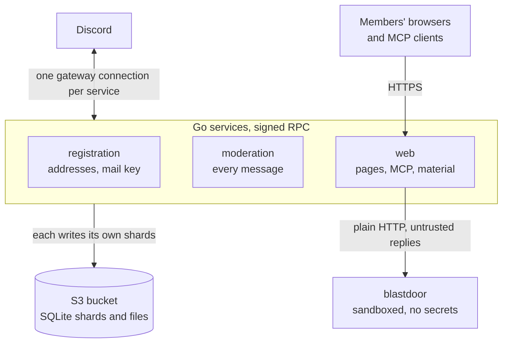

# Steki Discord Bot

The Steki Discord server is a community of university students. This repository holds
the software that administers it. The bot admits members after verifying a student email
address, moderates messages, and distributes course material through a web page and a
Model Context Protocol (MCP) endpoint.

The program is written in Go and deployed on [Railway](https://railway.com). Persistent
data are SQLite files stored in an S3 bucket. There is no database server and no
attached volume.

## Functions

- **Registration.** A new member receives a private channel and submits a student email
  address. The member confirms on a consent page, protected by an ALTCHA proof of work,
  that the Discord account and the address belong together, and then receives a role.
- **Moderation.** Every message is screened for scam links, spam and invitations to other
  servers. Media from new or hijacked accounts is held. Long-silent members are marked,
  and edits and deletions are logged.
- **Course material.** PDFs and JPEGs posted in course channels are backed up, screened
  and listed on a searchable study page. Members can also upload through the bot.
- **MCP server.** Members read the course material from an AI assistant after logging in
  with Discord.
- **Abuse defence.** Addresses that scan or flood the web pages are challenged or banned,
  at the application and at Railway's edge.

## Architecture

### The design problem

The bot has two properties that conflict when they share a process. It handles input from
untrusted parties: every message on the server, files uploaded by students, and requests
from the public internet. It also holds material that must stay private: members' email
addresses, the key of the mail provider, and the keys that sign access tokens. In a
single process, a flaw in any input path, such as an image decoder, exposes everything
the process holds.

### Division by privilege

The bot is therefore divided by privilege, not by feature. Discord sees one bot, but
three Go services each open their own gateway connection with the same token and act only
on the events that concern them. A fourth unit, `blastdoor`, handles hostile files.



| Unit | Exposed to | Holds | Does not hold |
|---|---|---|---|
| `registration` | joining members, the mail provider | member addresses, mail API key | web pages, uploaded files |
| `moderation` | every message | message cache, phishing list | addresses, mail key, files |
| `web` | the internet, uploads | token-signing key, OAuth application, Gemini and Railway tokens | mail key, addresses |
| `blastdoor` | file bytes from `web` | nothing | every secret and the bucket credentials |

A compromise of one unit yields only what that unit holds. `moderation` reads the most
input, so it is given the least. `blastdoor` runs the image decoder (libheif) and the
compressor (zstd) under a seccomp filter that forbids creating sockets. The design
assumes that it can be compromised, and `web` therefore validates what it returns.

Four tests in [`services/`](services/) enforce the division. They fail when a service
links a package outside its lane, when a secret is read by the wrong service, when a
slash command has zero or two owners, or when a service's deploy watch list omits a
package it links. An isolation rule that depends on convention erodes, so these tests
are part of every pull request check.

### Communication between services

The services share no database. One service reaches another's data only through the
internal API in [`internal/rpc/`](internal/rpc/): signed JSON over HTTP on a port with no public route. The
owner of the data decides and the caller asks. For example, `moderation` cannot write the
address table, and to ban a person it asks `registration` to ban the address.

### Persistence

Each SQLite file, called a shard, has exactly one writing service. Each shard has its own
Go type, so a service cannot compile a query against a shard it does not own. The bucket
holds the authoritative copy and the container's scratch disk holds a working copy. A
write is reported as complete only after its changes are in the bucket, and a starting
service raises an epoch number in the shard's manifest so that the previous deployment's
next write is refused. A deploy therefore cannot produce two writers. A service refuses
to start from a missing or damaged shard, because an empty address table would allow
members to reuse addresses that are already taken.

This arrangement follows from the service division. A single writer per shard needs no
database server, and the bucket already stores the course files. The details are in
[`internal/s3db/`](internal/s3db/).

### Costs of the design

- Each service keeps its own gateway connection and caches, so three processes use more
  memory than one. Each is held to a soft 24 MiB Go heap.
- There are more deployments and an internal API to maintain.
- The bucket credentials reach every object. A compromised service could read another's
  shard directly, because Railway offers no per-prefix credentials. Separate buckets
  would remove this limit.

[docs/ARCHITECTURE.md](docs/ARCHITECTURE.md) gives the full set of diagrams: package
dependencies, the call graph between services, the write path to the bucket, and the
registration, screening, material, MCP and shield flows.

## Documentation

| Purpose | Document |
|---|---|
| Understand the design | [docs/ARCHITECTURE.md](docs/ARCHITECTURE.md) |
| Contribute a change | [CONTRIBUTING.md](CONTRIBUTING.md) |
| Configure, deploy or operate the bot | [docs/OPERATIONS.md](docs/OPERATIONS.md) |
| Use or add a moderator command | [docs/COMMANDS.md](docs/COMMANDS.md) |
| Report a vulnerability | [SECURITY.md](SECURITY.md) |

### Layout

The repository root holds four directories: `cmd/` (one entry point per service),
`services/` (the logic of each service), `internal/` (packages the services share) and
`blastdoor/` (the sandboxed helper), besides `docs/`. Go forbids importing `internal/`
from outside this module, so the shared packages are not a public API.

| Package | Purpose |
|---|---|
| [`services/`](services/): [`registration`](services/registration/), [`moderation`](services/moderation/), [`web`](services/web/) | the logic of the three services |
| [`internal/bot/`](internal/bot/) | code shared by the services as Discord clients |
| [`internal/store/`](internal/store/) | typed access to the SQLite shards and their migrations |
| [`internal/s3db/`](internal/s3db/) | durable storage of SQLite files in a bucket |
| [`internal/rpc/`](internal/rpc/) | signed calls between services |
| [`internal/verify/`](internal/verify/) | the public HTTP pages |
| [`internal/mcp/`](internal/mcp/) | the MCP server and its OAuth authorization server |
| [`internal/materials/`](internal/materials/) | backup, screening and compression of course files |
| [`internal/shield/`](internal/shield/) | address challenges, bans and Under Attack Mode |
| [`blastdoor/`](blastdoor/) | the sandboxed image and compression service |

The remaining packages (`config`, `tokens`, `mail`, `dc`, `analytics`, `usernotes`,
`brand`, `moderation`) are described by their package comments, for example
`go doc ./internal/tokens`. Each service's entry point is in `cmd/<service>/`.

## Getting started

Building and testing require Go 1.26 and nothing else:

```bash
go build ./...
go vet ./...
go test ./...
```

Running the services requires a Discord test bot. Compose starts the whole mesh, that is
the three services, `blastdoor` and an S3-compatible bucket (RustFS) in place of the production one:

```bash
cp .env.example .env      # set DISCORD_TOKEN; GOOGLE_AI_TOKEN is optional
docker compose up --build
```

The web pages are then at <http://localhost:8080>. The top of
[`docker-compose.yml`](docker-compose.yml) holds the variables shared by the services,
and `.env.example` lists every variable. To run one service from Go instead, follow
[CONTRIBUTING.md](CONTRIBUTING.md#running-a-service-locally). A local run must never use
the production bucket, because a starting service takes the shard over and fences the
live one.

## Privacy

Analytics (PostHog) records only counts of interactions. No Discord ID, username, email
address, message text or IP address leaves the bot, and nothing is loaded into visitors'
browsers. Member addresses are stored only in the `registry` shard, which only
`registration` can read.

## Licence

[MIT](LICENSE).
