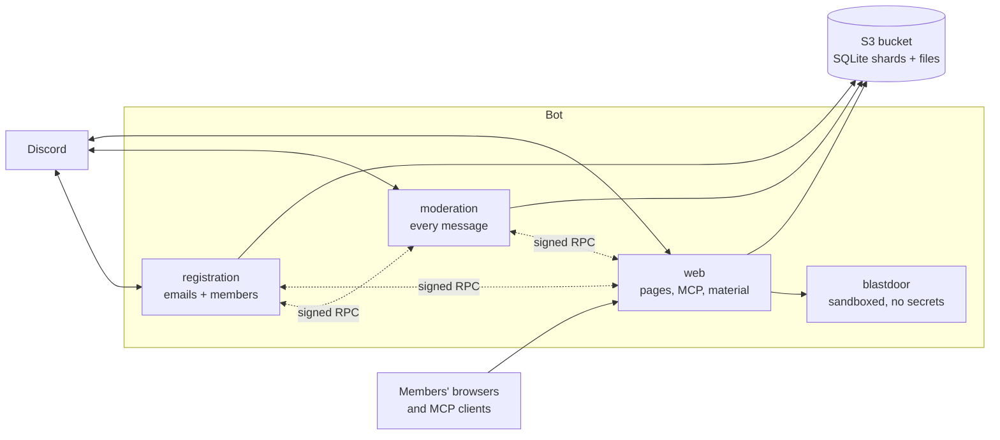

# Steki Discord Bot

The bot of the Steki Discord server, a community for university students. It lets
members in by verifying their student email, keeps the server clean, and shares course
material through a study page and an AI-assistant (MCP) endpoint.

Written in Go. Runs on [Railway](https://railway.com). Keeps its data in SQLite files
backed by an S3 bucket, with no database server and no volume.

## What it does

- **Registration.** A new member gets a private channel, gives their student address,
  and confirms on a consent page (behind an invisible ALTCHA proof of work) that their
  Discord account and the address belong together. Then they get their role.
- **Moderation.** Screens every message for scam links, spam and foreign invites, guards
  media from fresh or hijacked accounts, marks long-silent members, and logs edits and
  deletions.
- **Course material.** Backs up the PDFs and JPEGs posted in course channels, screens
  them, and serves a searchable study page with notes and ink. Members can upload
  through the bot.
- **MCP server.** Lets members read the course material from an AI assistant, with a
  Discord login.
- **Defence.** Per-address challenges and bans, mirrored to Railway's edge, and
  automatic Under Attack Mode.

## How it fits together

Discord sees one bot. Behind it are three Go services, each with its own gateway
connection, and a secret-free helper for hostile files:



The split is a security boundary: the service that reads every message holds no
addresses, the one facing the internet holds no mail key, and the one parsing strangers'
files holds nothing at all. Tests keep it that way.

**→ [docs/ARCHITECTURE.md](docs/ARCHITECTURE.md)** has the full set of diagrams:
package dependencies, the RPC call graph, how a write reaches the bucket, and the
registration, screening, material, MCP and shield flows.

## Documentation

| I want to… | Read |
|---|---|
| understand the design | [docs/ARCHITECTURE.md](docs/ARCHITECTURE.md) |
| contribute a change | [CONTRIBUTING.md](CONTRIBUTING.md) |
| configure, deploy or operate it | [docs/OPERATIONS.md](docs/OPERATIONS.md) |
| use or add a moderator command | [docs/COMMANDS.md](docs/COMMANDS.md) |
| report a vulnerability | [SECURITY.md](SECURITY.md) |
| work in one package | the README beside it, below |

### Package guide

| Package | Purpose |
|---|---|
| [`services/`](services/) · [`registration`](services/registration/) · [`moderation`](services/moderation/) · [`web`](services/web/) | the three services' logic |
| [`bot/`](bot/) | what the services share as Discord bots |
| [`store/`](store/) | typed access to the SQLite shards, and their migrations |
| [`s3db/`](s3db/) | the engine that keeps SQLite durable in a bucket |
| [`rpc/`](rpc/) | signed service-to-service calls |
| [`verify/`](verify/) | the public HTTP pages |
| [`mcp/`](mcp/) | the MCP server and its OAuth |
| [`materials/`](materials/) | course-file backup, screening, compression |
| [`shield/`](shield/) | IP challenges, bans, Under Attack Mode |
| [`blastdoor/`](blastdoor/) | the sandboxed image and compression service |

Smaller packages (`config`, `tokens`, `mail`, `dc`, `analytics`, `usernotes`, `brand`,
`moderation`) are described by their package comment: `go doc ./tokens`.

## Getting started

You need Go 1.26. Nothing else is needed to build and test:

```bash
go build ./...
go vet ./...
go test ./...
```

To run a service you need a Discord test bot and a bucket (a local MinIO is fine);
[CONTRIBUTING.md](CONTRIBUTING.md#running-a-service-locally) walks through it.
`.env.example` is the annotated list of variables. **Never point a local run at the
production bucket**: taking a shard over fences the live service.

## Repository layout

```
cmd/              main.go, Dockerfile and Railway settings, one folder per service
services/         the registration, moderation and web services' logic
bot/  config/  dc/  store/  s3db/  rpc/  tokens/  analytics/  brand/
                  shared by the services
verify/  mcp/  materials/  usernotes/  shield/        web-only
mail/                                                 registration-only
blastdoor/        the sandboxed helper, with its own main and Dockerfile
docs/             architecture, operations, moderator commands
```

## Privacy

Analytics (PostHog) only counts interactions: no Discord ID, username, email, message
text or IP address leaves the bot, and nothing is loaded into visitors' browsers.
Members' addresses live only in the `registry` shard, readable only by `registration`.

## Licence

[MIT](LICENSE).
