# Architecture

How the Steki bot is put together, and why. Diagrams are [Mermaid](https://mermaid.js.org/),
which GitHub renders in place. If you change behaviour a diagram shows, change the
diagram in the same pull request.

- [The big picture](#the-big-picture)
- [Why three services and a blastdoor](#why-three-services-and-a-blastdoor)
- [Code layout and who may import what](#code-layout-and-who-may-import-what)
- [Service-to-service calls](#service-to-service-calls)
- [Data: SQLite shards in a bucket](#data-sqlite-shards-in-a-bucket)
- [Flows](#flows)
  - [Registration](#registration)
  - [Message screening](#message-screening)
  - [Course material: backup, screening, viewing](#course-material-backup-screening-viewing)
  - [MCP server](#mcp-server)
  - [IP shield](#ip-shield)
- [Process lifecycle](#process-lifecycle)
- [Secrets and trust boundaries](#secrets-and-trust-boundaries)

## The big picture

Discord sees a single bot. Behind it are three Go services that each open their own
gateway connection with the same token and ignore events that are not theirs, plus
`blastdoor`, a secret-free helper that handles hostile files.

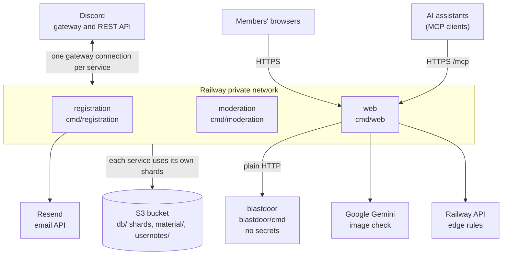

The three services call one another over signed RPC on port 8081, drawn in
[Service-to-service calls](#service-to-service-calls). All three also send anonymous
counts to PostHog, which is omitted here.

| Service | Role | Owns |
|---|---|---|
| [`registration`](../services/registration/) | register channels, email link, reaper, `/reg`, `/email` | `registry` shard, Resend key, member addresses |
| [`moderation`](../services/moderation/) | screens messages, media guard, ghost role, edit/delete logs, installs slash commands | `guard` and `activity` shards, message cache, phishing list |
| [`web`](../services/web/) | public pages, MCP server, course material, IP shield | `library` shard, `JWT_SECRET`, OAuth, Gemini and Railway tokens |
| [`blastdoor`](../blastdoor/) | converts images, compresses files, in a sandbox | nothing |

## Why three services and a blastdoor

The split is a security boundary first and a memory trade-off second.

- **Least privilege.** The service that reads every message (`moderation`) holds no
  mail key and no member's address. The service that faces the internet (`web`) holds
  no mail key either and cannot link the other services' logic. The service that holds
  the addresses (`registration`) serves no web pages and handles no uploaded files.
  A bug in one gives an attacker only what that service holds.
- **Hostile input is isolated.** Strangers' images are parsed by libheif, and files are
  compressed with zstd, inside `blastdoor`: a container with no secrets and no bucket
  credentials, running under a seccomp sandbox that forbids creating sockets. Treat it
  as already compromised.
- **The cost.** Each service keeps a gateway connection and a state cache, so three
  processes use more memory than one. Each is held under a soft 24 MiB Go heap
  (`bot.TuneRuntime`).

These rules are enforced by tests, not by convention. See
[Guardrail tests](#guardrail-tests).

## Code layout and who may import what

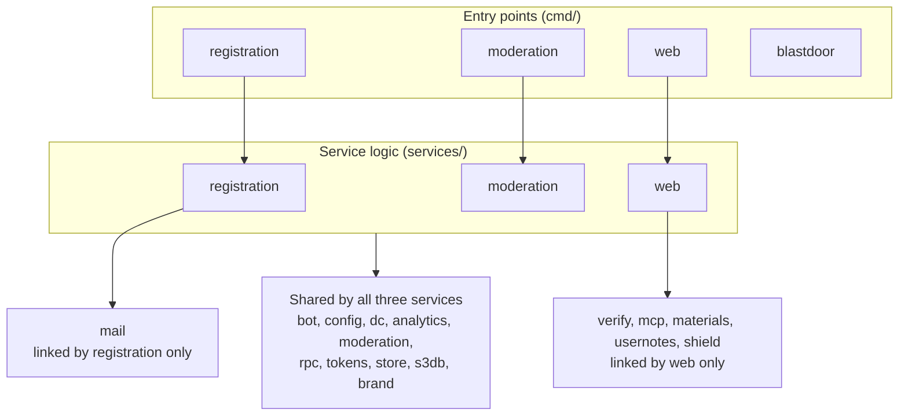

Within the shared group, `bot` builds on `config`, `store` and `s3db`; `rpc` builds on
`tokens` and `store`; `store` builds on `s3db`. `mail` and `verify` use `brand`.

Directory guide:

| Path | What it is |
|---|---|
| `cmd/<service>/` | `main.go`, `Dockerfile` and `settings.toml` for one service |
| `services/<service>/` | event handlers, slash commands and RPC handlers of that service |
| `internal/bot/` | what every Discord service shares: `Core`, gateway session, panic guard, graceful shutdown, command definitions, runtime tuning |
| `internal/config/` | per-service environment loaders, plus the guild's channel, category and role IDs as constants |
| `internal/store/` | the persistence layer, one Go type per shard, plus embedded SQL migrations |
| `internal/s3db/` | the engine that keeps a SQLite file durable in a bucket |
| `internal/rpc/` | signed service-to-service JSON calls |
| `internal/tokens/` | signed links (email, captcha, material, MCP guide) and the ALTCHA captcha |
| `internal/verify/` | the public HTTP pages and middleware (`web` only) |
| `internal/mcp/` | MCP server and its OAuth 2.1 authorization server (`web` only) |
| `internal/materials/` | course-file backup worker, screening and compression (`web` only) |
| `internal/shield/` | per-address abuse detection and Railway edge rules (`web` only) |
| `blastdoor/` | the sandboxed image and compression service |
| `internal/mail/` | the registration email (`registration` only) |
| `internal/moderation/` | the mod log channel and the blacklisted-link filter, shared helpers |
| `internal/usernotes/` | per-member study notes, one SQLite object per member |
| `internal/dc/` | bounded retries, error classification and register-channel placement |
| `internal/analytics/` | anonymous PostHog events |
| `internal/brand/` | logos and university names |

### Guardrail tests

Four tests in [`services/`](../services/) keep the architecture honest. Run them before
you open a pull request; each fails with a message naming the offender.

| Test | Fails when |
|---|---|
| `TestServicesStayInTheirLane` | a service's binary links a package it is forbidden to (for example `moderation` linking `mail`) |
| `TestSecretsStayWithTheirService` | a secret variable appears in the wrong service's config loader |
| `TestEveryCommandHasOneOwner` | a slash command is answered by zero or by two services |
| `TestWatchPatternsCoverEveryDependency` | a package a service links is missing from its `settings.toml` watch patterns, so a change would not redeploy it |

## Service-to-service calls

Nothing shares a database. A service reaches another's data only through its internal
API in [`internal/rpc/`](../internal/rpc/): JSON over HTTP on port 8081, which has no public route.
Requests carry an HMAC signature and timestamp derived from `INTERNAL_SECRET` and are
refused after one minute.

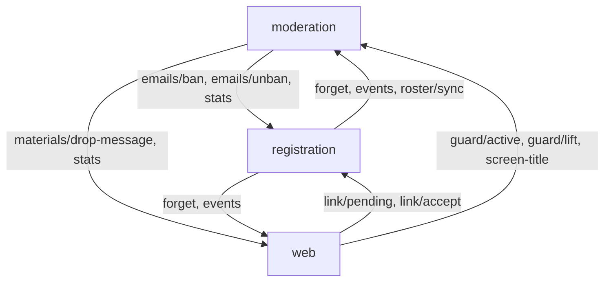

Each arrow points from the caller to the service that answers. The purpose of each
route is in the [route table](../internal/rpc/README.md#routes): `link/*` serves the email consent
page, `emails/*` serves `/member ban`, `forget` and `events` serve `/reg forget` and
`/reg history`, `guard/*` serves the captcha page, and `drop-message` hides the post of a
restricted author.

Rules of thumb:

- Add a route as a constant in `internal/rpc/rpc.go`, register it with `rpc.Handle` in the
  owner's `API` method, and call it from the caller. Typed request and response
  structs keep both ends in step.
- The owner decides; the caller asks. `moderation` never writes the address table, it
  asks `registration` to ban an email.
- `blastdoor` is **not** an RPC peer. It has no secret and is called over plain HTTP;
  `web` must assume its answers could be forged and check them.

## Data: SQLite shards in a bucket

There is no database server and no volume. Each shard is a SQLite file on the
container's scratch disk with exactly one writing process; the S3 bucket holds the
truth. Details are in [`internal/s3db/README.md`](../internal/s3db/README.md).

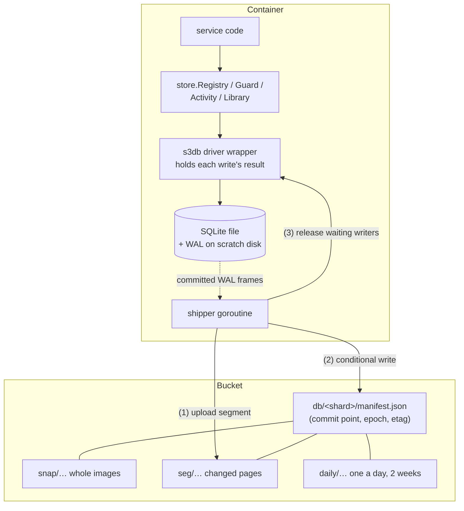

| Shard | Written by | Holds | A write returns |
|---|---|---|---|
| `registry` | registration | addresses, members, registrations, bans | once in the bucket |
| `guard` | moderation | media guard | once in the bucket |
| `activity` | moderation | when members last spoke | at once, shipped every 30 s |
| `library` | web | materials, reports, stickies, IP blocks, study notes | once in the bucket |

Each shard type is a distinct Go type, so a service that holds one cannot even compile
a query against another's tables.

## Flows

### Registration

A new member proves they own a university address. The email carries a link, not a
code; the member opens it, sees their Discord avatar beside the address, and accepts
behind an invisible ALTCHA proof of work.

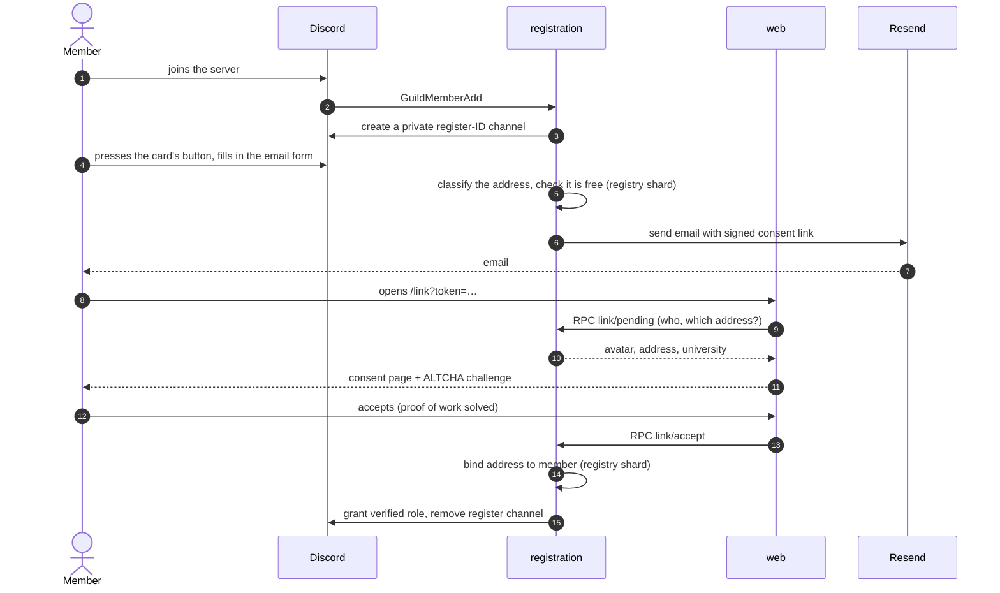

If the member goes quiet, the **reaper** sends one reminder after 1 h and kicks after
6 h (never a verified member). The full list of stability behaviours is in
[`OPERATIONS.md`](OPERATIONS.md#how-it-stays-stable).

### Message screening

`moderation` and `web` each see every message at the same moment. Screening is not a
step before recording.

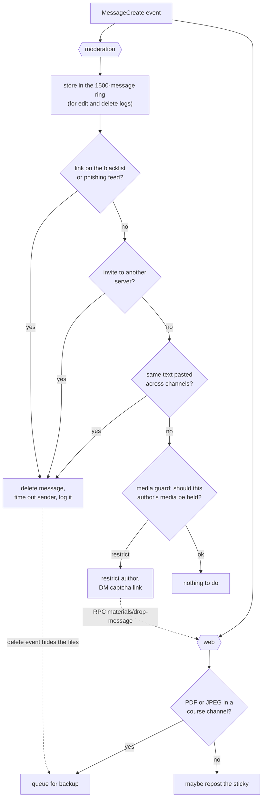

### Course material: backup, screening, viewing

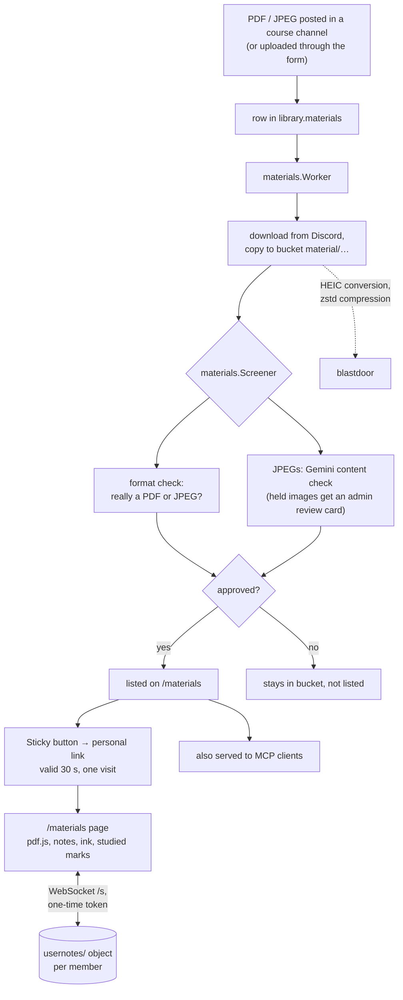

Deleting a Discord message hides its files from the page; it never removes them from
the bucket. Only a moderator's `/materials remove` does that.

### MCP server

`web` serves course material to AI assistants over MCP (Streamable HTTP, stateless)
behind its own OAuth 2.1 authorization server that logs members in with Discord.

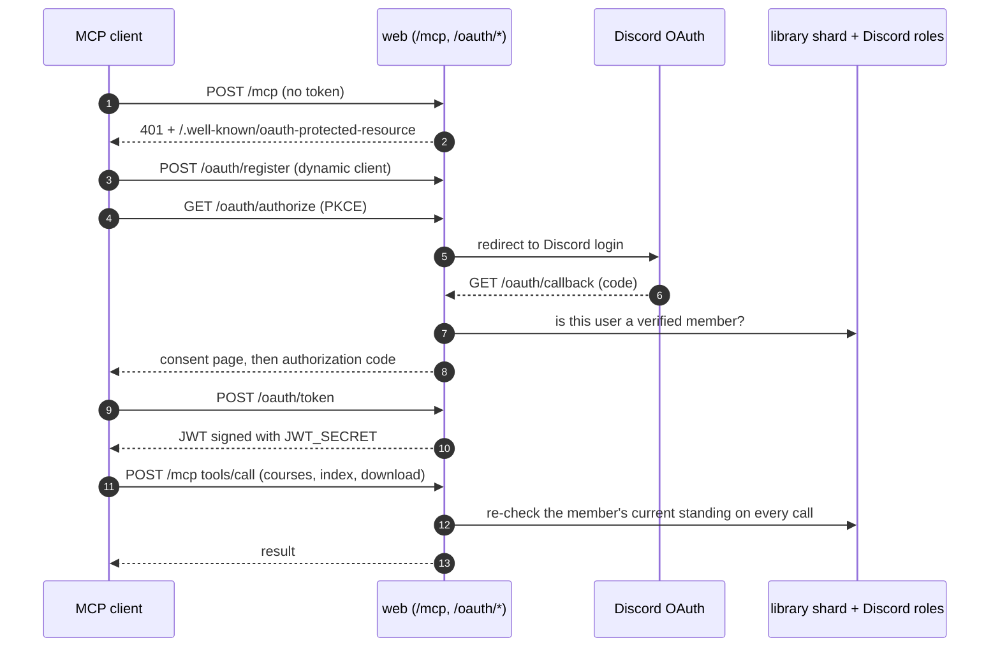

The endpoint is read-only by construction: the only tools list the course channels,
read a channel's index and download a file.

### IP shield

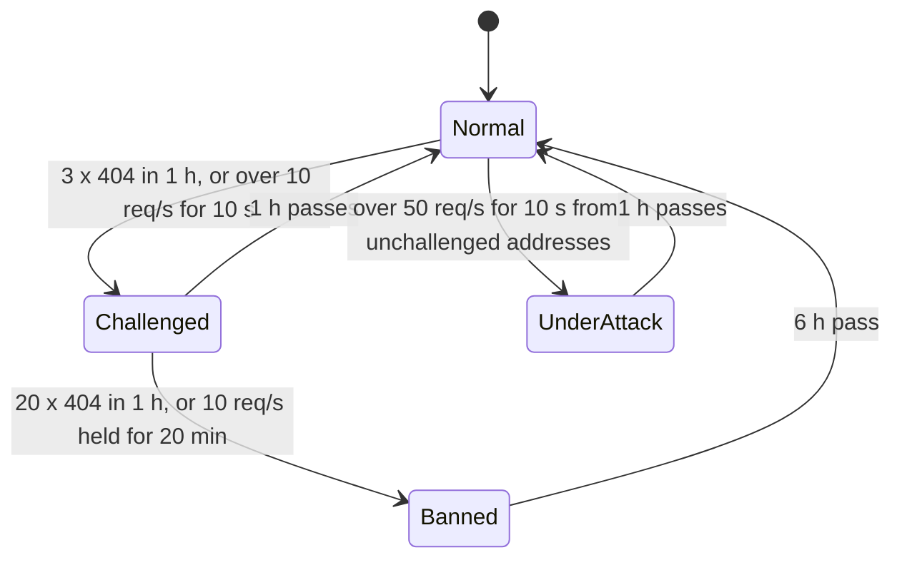

Blocks are stored in `library.ip_bans`, restored on start-up, and (with
`RAILWAY_TOKEN`) pushed to Railway edge rules so the edge stops them first. The bot
also refuses banned addresses itself.

## Process lifecycle

Every service follows the same shape in `main.go`:

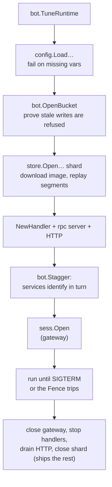

The **fence** is how a deploy hands a shard over safely: a starting service raises the
manifest's epoch; the old deployment's next write is refused, it shuts itself down, and
Railway is told not to restart it into its successor's way
(`restartPolicyType = "ON_FAILURE"`).

## Secrets and trust boundaries

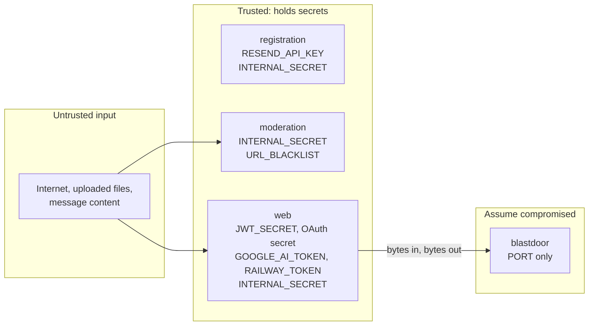

- Email and captcha links are signed with a key derived from `INTERNAL_SECRET`, because
  `registration` and `moderation` issue them.
- Everything only `web` issues (material links, sockets, MCP tokens) is signed with
  `JWT_SECRET`, so a compromised `registration` or `moderation` cannot forge them.
- Known limit: the bucket's credentials reach every object, so a compromised service
  could read other shards directly. Railway has no per-prefix credentials; separate
  buckets would close this.
