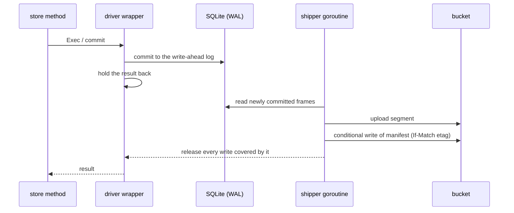

# s3db

Keeps SQLite databases in an S3 bucket without a volume. Each shard is an ordinary SQLite
file on the container's scratch disk, written by exactly one process, and the bucket holds
the authoritative copy. The package is used through [`store/`](../store/); services do
not call it directly. See the
[architecture](../../docs/ARCHITECTURE.md#data-sqlite-shards-in-a-bucket).

## Bucket layout

```
db/<shard>/manifest.json   the commit point: which objects make the database
db/<shard>/snap/…          whole images: the current one and three earlier ones
db/<shard>/seg/…           pages changed since the current image
db/<shard>/daily/…         one image a day, kept for two weeks
material/…                 course material, compressed by blastdoor
user-notes/…               members' notes, one SQLite file each
```

Nothing under `db/` is compressed, so an image opens with any SQLite tool. To inspect a
shard, fetch its manifest and the objects it lists, or take `daily/<date>.db` for the
state on a given day.

## How a write becomes durable



- **Commit.** SQLite commits to its write-ahead log (WAL) as usual. One goroutine uploads
  the committed frames as a segment and adds it to the manifest. A wrapper around the SQL
  driver withholds each write's result until that has happened, so the SQL in `store`
  does not depend on it. Writes that wait together share one upload. Reads never wait, so
  they continue while the bucket is unavailable.
- **Fencing.** A starting service raises the manifest's epoch, and every manifest write
  is conditional on the etag the writer last saw. The next write of an older deployment
  is therefore refused and that deployment shuts down. If it is restarted, it finds
  itself on the retired list and stays out. A service refuses to start on a bucket that
  accepts a stale conditional write (`s3db.Verify`), because fencing would not hold.
- **Compaction.** Automatic checkpoints are disabled, so the main file changes only when
  the engine decides, and it can be copied as a stable image while writes continue. If
  the log restarts with frames that were never shipped, no segment is written until a new
  image exists.
- **Failure.** While the bucket is unavailable, a write returns an error stating that it
  is not yet durable, and shipping keeps retrying. A missing or damaged object, or a
  shard that does not exist, stops the service. It never starts from less than the whole
  database, since an empty registry would allow members to reuse addresses already taken.
  `DB_CREATE_EMPTY=1` overrides this for local development only.

The `activity` shard does not wait: its writes return at once and are shipped every 30
seconds. Members' page notes are not a shard; see [`usernotes/`](../usernotes/).

## Contents

`driver.go` wraps the `database/sql` driver, `shard.go` manages a shard's lifecycle
(open, ship, snapshot, fence, close), `wal.go` reads committed frames from the log, and
`objects.go` defines the `Objects` bucket interface, its S3 implementation and `Verify`.

## Testing

`go test ./s3db` uses an in-memory bucket defined in the tests. Setting
`STEKI_TEST_S3="endpoint region key secret bucket"` also runs `integration_test.go`
against a real S3 server. Use a scratch bucket, since those tests write to it.
