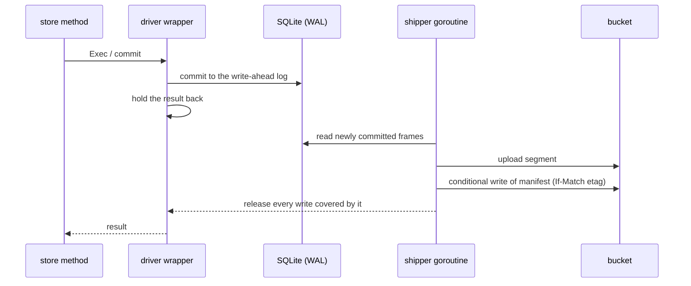

# s3db

Keeps SQLite databases in an S3 bucket with **no volume**. Each shard is an ordinary
SQLite file on the container's scratch disk with exactly one writing process; the bucket
holds the truth. Used through [`store/`](../store/); services never touch it directly.

Part of the [architecture](../docs/ARCHITECTURE.md#data-sqlite-shards-in-a-bucket).

## Bucket layout

```
db/<shard>/manifest.json   the commit point: which objects make the database
db/<shard>/snap/…          whole images, the current one and three before it
db/<shard>/seg/…           the pages changed since the current image
db/<shard>/daily/…         one image a day, kept for two weeks
material/…                 course material, blastdoor-compressed
user-notes/…               members' notes, one SQLite file each
```

Nothing under `db/` is compressed: an image opens as it is with any SQLite tool. To
inspect a shard, fetch its manifest and objects, or take `daily/<date>.db` for a day's
copy.

## How a write becomes durable



- **Commit.** SQLite commits to its WAL as usual. One goroutine uploads the committed
  frames as a segment and adds it to the manifest. A wrapper around the SQL driver
  holds each write's result back until then, so the store's SQL knows nothing of this.
  Writes waiting together share an upload. Reads never wait, so they keep working while
  the bucket is down.
- **Fencing.** A starting service raises the manifest's epoch, and every manifest write
  is conditional on the etag it last saw. An older deployment's next write is refused
  and it shuts down; if restarted, it finds itself on the retired list and stays out. A
  service refuses to start on a bucket that does not refuse a stale conditional write
  (`s3db.Verify`).
- **Compaction.** Automatic checkpoints are off, so the main file only changes when the
  engine says so, which makes it a stable image to snapshot while writes carry on. If
  the log ever restarts with frames unshipped, no segment is written until a new image
  exists.
- **Failure.** With the bucket down a write returns an error saying it is not yet
  durable, and shipping keeps retrying. A missing or damaged object, or a shard that
  does not exist, stops the service: it never starts from less than the whole database,
  since an empty registry would let members reuse taken addresses. (`DB_CREATE_EMPTY=1`
  overrides this for local development only.)
- **Notes.** Members' page notes are not a shard; see [`usernotes/`](../usernotes/).

The `activity` shard opts out of waiting: its writes return at once and ship every 30 s.

## Files

| File | Holds |
|---|---|
| `driver.go` | the `database/sql` driver wrapper that holds results back |
| `shard.go` | a shard's lifecycle: open, ship, snapshot, fence, close |
| `wal.go` | reading committed frames from the SQLite log |
| `objects.go` | the `Objects` bucket interface, the S3 implementation and `Verify` |

## Testing

`go test ./s3db` uses an in-memory bucket defined in the tests. Set
`STEKI_TEST_S3="endpoint region key secret bucket"` to also run against a real S3
server (`integration_test.go`). Use a scratch bucket: the tests write to it.
